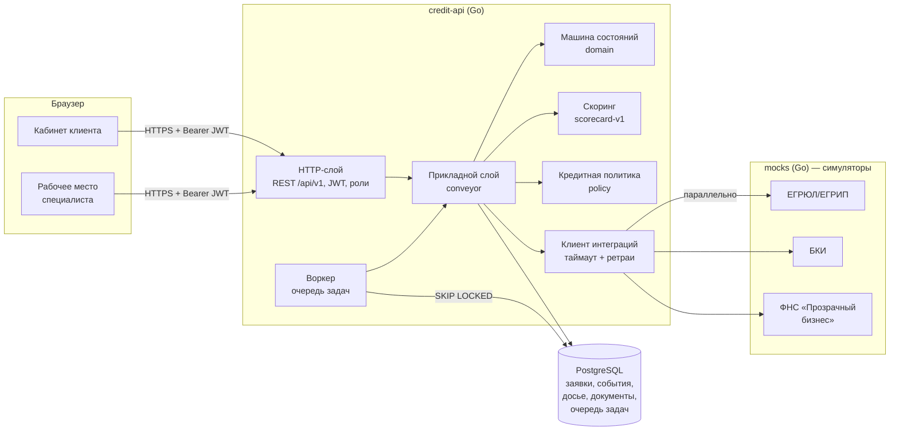
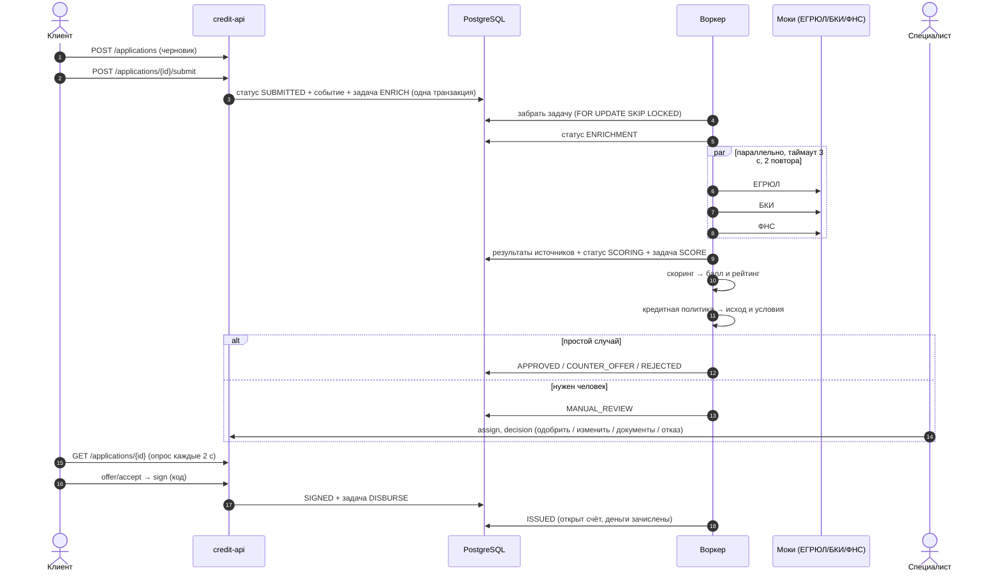

# Архитектура

## Схема

Развёртывание (`docker-compose.yml`): `postgres`, `mocks`, `api` (раздаёт и API, и веб-интерфейс), `swagger` (Swagger UI).

## Сквозной поток заявки

## Модули

| Пакет | Ответственность | Зависит от |
|---|---|---|
| `internal/domain` | Статусы, таблица переходов, продукты, подбор продукта под задачу, аннуитет, проверка ИНН | — |
| `internal/scoring` | Балльная модель риска заёмщика: факторы, стоп-факторы, рейтинг | domain-типы интеграций |
| `internal/policy` | Кредитная политика: из балла и параметров заявки — исход, ставка, лимит, контрпредложение, признаки ручного разбора | domain, scoring |
| `internal/conveyor` | Сценарии: клиент, специалист, системные шаги. Единая точка смены статуса `transition()` | всё выше, store, integrations |
| `internal/store` | SQL и маппинг, миграции, очередь задач | — |
| `internal/integrations` | Контракты и HTTP-клиент к внешним источникам | — |
| `internal/worker` | Разбор очереди, повторы с backoff, возврат «зависших» задач | conveyor, store |
| `internal/httpapi` | REST, аутентификация, роли, формат ошибок, раздача SPA | conveyor, store |
| `internal/mocks` + `cmd/mocks` | Симуляторы ЕГРЮЛ, БКИ, ФНС с переключаемыми отказами | integrations |
| `web/static` | SPA на чистом JS (ES-модули), без сборки | API |

**Ключевой принцип:** скоринг и решение разделены. `scoring` отвечает на вопрос «насколько рискован заёмщик», `policy` — «что банк готов предложить по этой заявке». Модель риска можно перекалибровать, не трогая правила банка, и наоборот. Оба модуля — чистые функции, покрыты unit-тестами без БД.

## Надёжность

- **Transactional outbox.** Фоновые задачи (`jobs`) создаются в той же транзакции, что и смена статуса. Нет «заявки, которая подана, но никогда не обработается».
- **Конкурентная обработка.** Воркер забирает задачи через `FOR UPDATE SKIP LOCKED`: можно запустить несколько реплик `api` без двойной обработки. Задачи, «зависшие» в `RUNNING` после падения процесса, возвращаются в очередь через 2 минуты.
- **Повторы.** Ошибка шага → повтор с экспоненциальной задержкой (до 5 попыток). HTTP-вызовы источников — таймаут 3 с, 2 повтора с backoff.
- **Деградация.** Недоступный источник не останавливает конвейер: результат `ERROR` сохраняется в досье, скоринг считается по имеющимся данным, заявка уходит на ручной разбор с пометкой «нет данных из …». Демо: ООО «Туман» (БКИ «зависает»), либо `PUT /admin/sources/BKI {"mode":"ERROR"}` на моках.
- **Идемпотентные шаги.** Каждый шаг сначала проверяет статус заявки. Повтор после сбоя продолжает с места остановки или ничего не делает.
- **Graceful shutdown.** По SIGTERM сервер перестаёт принимать запросы, воркер дожидается текущих задач.
- **Health-checks.** `/healthz` (живость), `/readyz` (доступность БД). Используются в `docker-compose` (`depends_on: service_healthy`).
- **Миграции** встроены в бинарник и выполняются при старте под advisory lock (безопасно при нескольких репликах).

## Безопасность

- **Аутентификация:** JWT HS256 с проверкой issuer и срока; пароли — PBKDF2-SHA256, 210 000 итераций, соль. Ограничение попыток входа (10 в минуту с адреса).
- **Авторизация:** роль проверяется на уровне маршрутов (`requireRole`) и повторно — машиной состояний (кто может выполнять переход). Роль и компания берутся из БД при каждом запросе, а не из токена.
- **Изоляция данных клиентов:** клиент видит только заявки своей компании. Чужая заявка — `404`, а не `403`, чтобы не раскрывать факт её существования.
- **Разделение видимости:** балл, рейтинг, факторы, обоснование и внутренние комментарии банка клиенту не отдаются. Клиент видит отказ в понятных формулировках без раскрытия модели.
- **Ввод:** JSON с запретом неизвестных полей и лимитом 1 МБ; файлы — белый список расширений, лимит 10 МБ; ИНН — проверка контрольных разрядов; SQL — только параметризованные запросы, колонки для `UPDATE` — из белого списка.
- **Заголовки:** CSP (`script-src 'self'`), `X-Frame-Options: DENY`, `nosniff`, `no-referrer`. Весь пользовательский текст экранируется при выводе.
- **Логи:** структурированный JSON с `request_id`, без тел запросов и персональных данных.
- **Цепочка поставок:** у фронтенда ноль npm-зависимостей, у бэкенда 4 прямых Go-модуля (см. THIRD_PARTY_NOTICES). Сборка воспроизводима по `go.sum`.

## Масштабирование (путь к промышленной версии)

| В прототипе | В промышленной версии | Почему так сейчас |
|---|---|---|
| Очередь задач в PostgreSQL | Kafka / RabbitMQ, отдельные сервисы-потребители | Одна зависимость, транзакционная гарантия «из коробки» |
| Монолит с модулями | Выделение `scoring`/`policy` в decision-сервис, интеграций — в шлюз | Границы модулей уже проведены, выделение механическое |
| JWT, выдаваемый сервисом | Внешний IdP (Keycloak / корпоративный SSO), сервис только проверяет токены | Меньше движущихся частей для проверки жюри |
| Документы в `bytea` | S3-совместимое хранилище + антивирусная проверка | Достаточно для файлов до 10 МБ |
| Опрос статуса раз в 2 с | WebSocket / SSE | Проще и надёжнее для демо, нагрузка мизерная |
| Правила политики в коде | Справочник правил с версионированием (BRMS) | Правила прозрачны, покрыты тестами |
| Моки внешних источников | Реальные интеграции через корпоративную шину, кэш выписок | Нет доступа к системам банка (условие кейса) |

Сервис `api` не хранит состояние в памяти (кроме лимита попыток входа), поэтому масштабируется горизонтально за балансировщиком.
