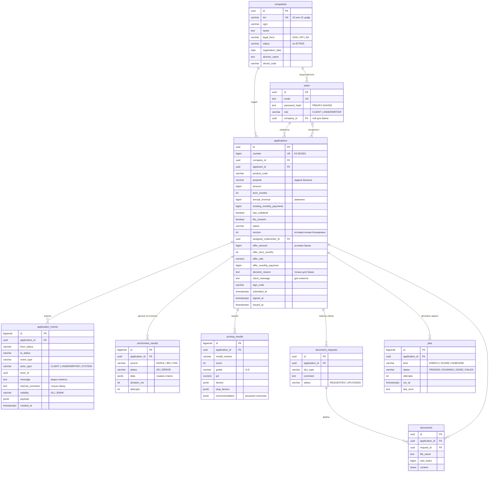

# Модель данных

Схема — [`migrations/001_init.sql`](../migrations/001_init.sql). Денежные суммы хранятся в `bigint` целыми рублями: без плавающей точки и ошибок округления.

## Принципы

- **Журнал событий только дополняется.** `application_events` — история статусов и аудит действий: кто, когда, что сделал, с каким комментарием. Поле `visibility` отделяет то, что видно клиенту, от внутренних записей банка.
- **Снимки данных источников.** `enrichment_results.data` хранит ответ источника на момент решения. Решение можно воспроизвести и объяснить даже после того, как данные в реестре изменятся. При повторной обработке добавляется новая запись, старые не перезаписываются.
- **Версионирование модели.** `scoring_results.model_version` фиксирует, какой версией модели получена оценка, а `recommendation` — что предложила политика. Это нужно для аудита и сравнения версий модели.
- **Условия оффера — отдельно от запроса.** `amount`/`term_months` — что просил клиент, `offer_*` — что предложил банк. Клиент видит оба значения, изменённые зачёркнуты.
- **Каталог продуктов — в коде** (`internal/domain/products.go`). Для MVP это прозрачнее, условия версионируются вместе с кодом и тестами. В промышленной версии — справочник в БД с историей.

## Индексы

| Индекс | Для чего |
|---|---|
| `applications (company_id, created_at DESC)` | Список заявок клиента |
| `applications (status, status_changed_at)` | Очереди специалиста |
| `application_events (application_id, id)` | История заявки |
| `enrichment_results (application_id, source, id DESC)` | Последний ответ каждого источника |
| `jobs (run_at) WHERE status = 'PENDING'` | Частичный индекс для выборки задач воркером |
