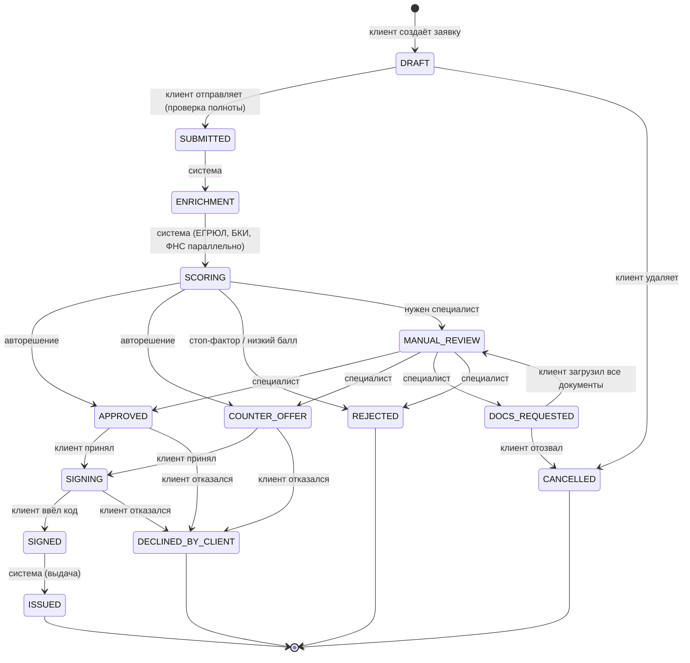

# Диаграмма состояний заявки

Единственный источник правды — таблица `transitions` в [`internal/domain/status.go`](../internal/domain/status.go).
Любая смена статуса проходит через неё: проверяется и сам переход, и роль инициатора (клиент / специалист / система).
Таблицу можно получить по API: `GET /api/v1/catalog/statuses`.

## Статусы

| Код | Для клиента | Кто действует дальше | Финальный |
|---|---|---|---|
| `DRAFT` | Черновик | Клиент | |
| `SUBMITTED` | Заявка принята | Система | |
| `ENRICHMENT` | Проверяем данные | Система | |
| `SCORING` | Оцениваем заявку | Система | |
| `MANUAL_REVIEW` | На рассмотрении у специалиста | Специалист | |
| `DOCS_REQUESTED` | Нужны документы | Клиент | |
| `APPROVED` | Одобрено | Клиент | |
| `COUNTER_OFFER` | Одобрено на других условиях | Клиент | |
| `SIGNING` | Подписание договора | Клиент | |
| `SIGNED` | Договор подписан, выдаём средства | Система | |
| `ISSUED` | Средства выданы | — | да |
| `REJECTED` | Отказ | — | да |
| `DECLINED_BY_CLIENT` | Вы отказались от предложения | — | да |
| `CANCELLED` | Заявка отозвана | — | да |

## Исходы решения

Решение не бинарное — четыре исхода, каждый с понятным следующим шагом для клиента:

| Исход | Статус | Что видит клиент | Его действие |
|---|---|---|---|
| Одобрено | `APPROVED` | Условия = запрошенным | Принять / отказаться |
| Одобрено на других условиях | `COUNTER_OFFER` | Новые сумма/срок, старые зачёркнуты | Принять / отказаться |
| Нужна доп. информация | `DOCS_REQUESTED` | Список документов с комментариями | Загрузить файлы в кабинете |
| Отказ | `REJECTED` | Причины в понятных формулировках (без раскрытия модели) | Подать новую заявку позже |

## Гарантии

- **Атомарность.** Смена статуса, запись в журнал событий и постановка следующей фоновой задачи выполняются в одной транзакции (transactional outbox): шаг не теряется при падении процесса.
- **Конкурентность.** Обновление идёт с условием `WHERE status = <ожидаемый>`, действия пользователей — дополнительно с проверкой `version` (оптимистичная блокировка). Два специалиста не примут два решения по одной заявке; второй получит `409 VERSION_CONFLICT`.
- **Идемпотентность.** Повторная отправка заявки и повторное выполнение фоновой задачи безопасны: шаг проверяет текущий статус и либо продолжает, либо ничего не делает.
- **Аудит.** Каждый переход фиксируется в `application_events`: кто (роль, id, имя), когда, из какого статуса в какой, сообщение для клиента и внутренний комментарий банка.
